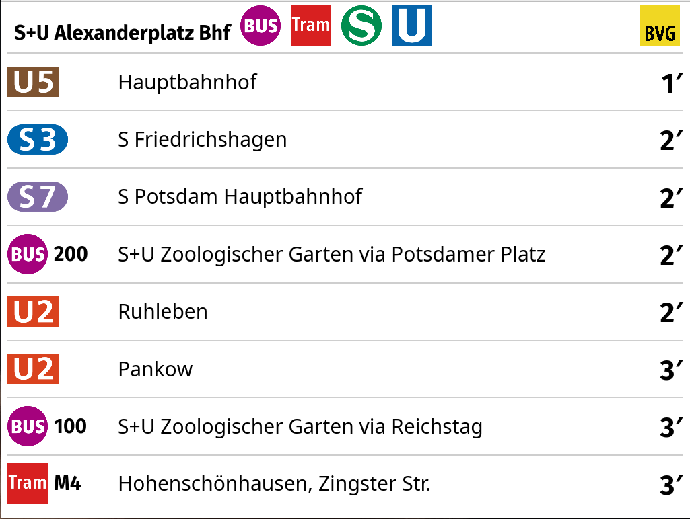
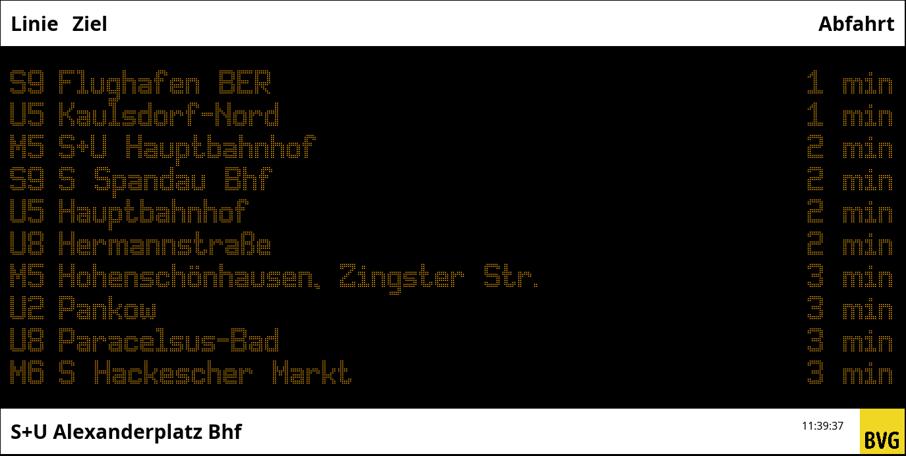

# bvg-display-rs

A departure display for Berlin public transport (BVG), written in Rust.
It fetches live departure data from the
[BVG Open API v6](https://v6.bvg.transport.rest/api.html) and renders it
in a native UI built with [iced](https://iced.dev/).

Two UI themes are available:

| Modern | Retro |
|--------|-------|
|  |  |